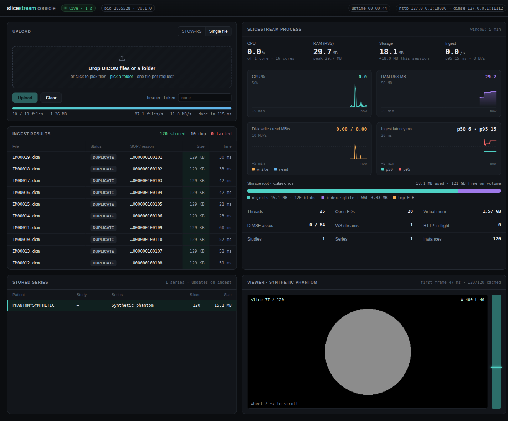

# slicestream

**A fast, memory-safe DICOM server in Rust that streams slices to the browser in the order the user scrolls through them.**

> Status: early (v0.1). The streaming core works end to end, with a browser test console.
> Instances can be stored over STOW-RS, a single-file upload or DIMSE C-STORE.
> Query/retrieve and the full DICOMweb read path are on the [roadmap](docs/ARCHITECTURE.md#roadmap).
> Not for clinical use.



## Why this project

Web viewers such as [OHIF](https://ohif.org) and [Cornerstone3D](https://cornerstonejs.org)
are mature. The bottleneck is usually the server:

- **Scroll lag.** Viewers fetch frames one request at a time and prefetch in a fixed
  order. OHIF maintainers note that scrolling turns laggy once one image takes more
  than about 250 ms to arrive.
- **Progressive codecs need server support.** Cornerstone3D can draw a usable
  image from the first bytes of an HTJ2K (RPCL) stream. In their 4G test, first
  render took 66 ms with streamed HTJ2K and about 4.6 s with JPEG-LS. Their docs
  also say most DICOMweb servers do not support this yet.
- **Rust options are thin.** [dicom-rs](https://github.com/Enet4/dicom-rs) covers
  parsing well. [DICOM-RST](https://github.com/UMEssen/DICOM-RST) is a DICOMweb
  gateway, but it does not serve pixel data or bulk data from S3. No Rust server
  does scroll-aware or progressive streaming.

Verdict: worth building. There is a real, measurable gap. The best way in is to
make **any standard DICOMweb client faster**, without replacing viewers. A
custom protocol only helps if clients can adopt it in a few lines of code.

## Why Rust

| Need | How Rust helps |
|---|---|
| Parse untrusted DICOM from the network | Memory safety rules out a whole class of parser CVEs that C/C++ PACS code has had. |
| Thousands of concurrent streams | `tokio` async I/O, no GC pauses, so tail latency stays predictable while users scroll. |
| Zero-copy frame serving | `bytes::Bytes` and (planned) mmap/`pread` send frame bytes straight from disk to socket. |
| CPU-heavy transcoding (JPEG → HTJ2K) | Native speed and safe parallelism (`rayon`), with no GIL. |
| Same code in the browser | The core crate can compile to **WASM** for a client-side scheduler and decoders. |
| Use from other languages | One core, many bindings: C ABI, Python (PyO3), Node (napi-rs). |
| Simple deployment | One static binary, small Docker image, low memory use. |

Trade-offs: the Rust medical-imaging ecosystem is younger than DCMTK or pydicom.
Some codecs (JPEG 2000, HTJ2K) still mean wrapping C libraries (OpenJPEG, OpenJPH)
for now.

## What works today

- `slicestream-core`: indexes a folder of DICOM files into ordered stacks.
  It sorts by `ImagePositionPatient` along the slice normal, not just
  `InstanceNumber`. It extracts native or encapsulated frames, including
  multi-frame files with a Basic Offset Table. It contains the scroll-aware
  `PrefetchScheduler` and the wire protocol.
- `slicestream-store`: crash-safe ingest into content-addressed blobs plus a
  SQLite index, with de-duplication and startup recovery.
- `slicestream-archive`: opens ZIP, 7z, RAR, tar, tar.gz and plain gzip
  files (nested in any combination) and finds DICOM and NIfTI files inside,
  with limits against zip bombs.
- `slicestream-dimse`: a C-STORE / C-ECHO storage SCP (default port 11112).
- `slicestream-server`: an axum server with a JSON API, single-frame HTTP fetch,
  and a WebSocket stream that changes its send order on every scroll event.
  It also accepts STOW-RS uploads, and runs the DIMSE SCP. The series list
  comes from the storage index, so new instances are streamable at once.
- `web/`: a dependency-free browser test console, served by the server itself:
  - **Upload**: drop files or a folder and send them one request each, over
    STOW-RS or as single files, with an optional bearer token.
  - **Archives and NIfTI**: drop a ZIP, 7z, RAR, tar or tar.gz, or a `.nii` /
    `.nii.gz` file. The console shows upload and processing progress, an
    expandable row per archive and a patient summary when it is done.
  - **Ingest results**: a stored / duplicate / failed line per file, with the
    reason for each failure.
  - **Process**: live CPU, memory, disk, ingest latency and connection counts
    for the server process, with the last five minutes as charts.
  - **Stored series**: every series in storage, updated as instances arrive.
  - **Viewer**: click a series to scroll through it (mouse wheel or arrow keys)
    over the streaming WebSocket.

- Archive ingest: DICOM inside archives goes through the normal ingest path.
  NIfTI volumes are stored as they are and linked to a patient or study when
  the archive makes that clear. See
  [docs/CONFORMANCE.md](docs/CONFORMANCE.md#archive-ingest).

On a local synthetic series of 120 slices at 256×256, the first frame arrives in
about 26 ms. Frames then come in this order: the cursor slice, the slices ahead
in scroll direction, then the slices behind.

## Quick start

Unix (Linux, macOS) is the supported platform: durable storage relies on
fsyncing directories, which Windows does not offer. Building needs Rust 1.88
or newer.

```sh
# 1. Generate a synthetic CT series (no patient data needed)
cargo run -p slicestream-core --example make_phantom -- data/phantom 120

# 2. Import it into storage (./storage by default)
cargo run -p slicestream-server -- import data/phantom

# 3. Serve it (HTTP on 127.0.0.1:8080, DIMSE C-STORE on port 11112)
cargo run -p slicestream-server -- serve

# 4. Open http://127.0.0.1:8080: the console shows the stored series, live
#    server metrics and an upload panel. Click the series and scroll.
```

`import <PATH>` takes a folder or a single file. A folder is read for
Part-10 files (`--recursive` descends into subfolders); archives and NIfTI
files inside it are opened or stored too. A file can be a ZIP, 7z, RAR, tar,
tar.gz, NIfTI or DICOM file. Files without the `DICM` preamble are skipped.
It prints one line per patient, then a summary line
`stored N · duplicate N · nifti N (linked N, unassigned N) · skipped N · failed N`.
The exit code is 0 on success, and 1 if any file failed or the import was
aborted (for example by a limit). Server logs go to stderr, so the summary on
stdout stays clean. One process owns a storage root (it
holds a lock on `<root>/LOCK`), so run `import` only while the server is
stopped. While `serve` runs, push instances with STOW-RS,
`POST /api/instances`, or C-STORE from a modality or another PACS (called AE
title `SLICESTREAM`). They show up without a restart.

Every setting has a default. To change them, copy
[`slicestream.example.toml`](slicestream.example.toml) and pass
`--config slicestream.toml` to `serve` or `import`. Unknown keys are an error.
`Ctrl-C` or `SIGTERM` stops the server gracefully.

## HTTP API (current)

| Method | Path | Returns |
|---|---|---|
| POST | `/dicom-web/studies` | STOW-RS: store a `multipart/related; type="application/dicom"` body |
| POST | `/dicom-web/studies/{study}` | STOW-RS into one study (each part must match) |
| POST | `/api/instances` | Store one Part-10 file sent as `application/dicom`; returns JSON |
| POST | `/api/archives` | Store an archive (ZIP, 7z, RAR, tar, tar.gz, gzip), a NIfTI file or one DICOM file sent as the raw body. Returns 202 `{"job", "upload_id"}`. Send the file name in `x-filename`, percent-encoded UTF-8 (`encodeURIComponent(name)`). Errors: 400 unsupported file, 401 bad token, 413 too large, 503 job queue full, 507 not enough free disk space. |
| GET | `/api/archives/{job}` | Progress and results of a job: `status` (`queued`, `running`, `done`, `aborted`), counts, per-entry results and a patient summary. 404 for an unknown job. Shows patient names, no token, no CORS. |
| GET | `/api/series` | JSON list of series summaries |
| GET | `/api/series/{uid}` | One series summary |
| GET | `/api/series/{uid}/frames/{index}` | Raw frame bytes. Metadata is in the `x-slicestream-frame-info` header. |
| GET | `/api/metrics` | Latest process, storage, ingest and connection numbers. Off with `metrics_enabled = false`, which also turns off the console's metrics and series panels. |
| GET | `/api/metrics/history` | The last 300 one-second samples, oldest first |
| GET | `/api/console/series` | Every series with study and patient details, for the test console |
| GET (WS) | `/api/series/{uid}/stream` | Scroll-aware frame stream. See [docs/PROTOCOL.md](docs/PROTOCOL.md). |

If `[http] stow_token` is set, the four POST endpoints need
`Authorization: Bearer <token>`. They never have CORS headers, so web pages on
other origins cannot upload. The read endpoints send CORS headers only for the
origins in `[http] cors_allowed_origins` (empty by default: no CORS), and the
WebSocket stream refuses other cross-origin pages with 403. The test console is
same-origin and needs neither.

Every request must carry an allowed `Host` header, or it gets 421 Misdirected
Request. This blocks DNS rebinding. By default the allowed hosts are
`localhost`, `127.0.0.1`, `[::1]` and the host of `[http] addr`. To reach the
server by another name (for example when binding `0.0.0.0`), list it in
`[http] allowed_hosts`.

Archive uploads can be turned off with `[archives] enabled = false` (both
routes then return 404). Limits are in the `[archives]` section of
[`slicestream.example.toml`](slicestream.example.toml).

## RAR and the UnRAR licence

RAR reading uses the bundled UnRAR library (through the `unrar_sys` crate).
Its licence is the "UnRAR freeware" licence by Alexander Roshal. It is free to
use, but it is not OSI-approved. It says UnRAR source code may be used in any
software to handle RAR archives free of charge, but it may not be used to
develop a RAR-compatible archiver or to re-create the RAR compression
algorithm. If you redistribute it, keep the full licence text
(`license.txt` in `unrar_sys`).

The `rar` cargo feature is on by default. To build without it:

```sh
cargo build --no-default-features
```

Without it, RAR entries fail with "RAR support not built in". Everything else
works the same.

## DIMSE

The storage SCP listens on `0.0.0.0:11112` with AE title `SLICESTREAM`
(`[dimse]` in the config). It handles C-ECHO and C-STORE.
`allowed_peers` limits which calling AE titles may connect.
Set `enabled = false` to turn it off.
See [docs/CONFORMANCE.md](docs/CONFORMANCE.md) for the conformance statement.

## Project layout

```
crates/slicestream-core     transport-agnostic library (index, frames, scheduler, protocol)
crates/slicestream-store    ingest pipeline, blob store and SQLite index
crates/slicestream-archive  archive walking (ZIP/7z/RAR/tar/gzip), NIfTI header parsing
crates/slicestream-dimse    DIMSE C-STORE / C-ECHO storage SCP
crates/slicestream-server   reference HTTP + WebSocket server (axum/tokio)
slicestream.example.toml    configuration with every default
web/                        browser test console (upload, metrics, series, viewer)
docs/ARCHITECTURE.md        target architecture and roadmap
docs/PROTOCOL.md            language-neutral wire protocol spec
```

## Contributing

See [CONTRIBUTING.md](CONTRIBUTING.md). **Never attach real patient data
(PHI) to issues or pull requests.** Use the phantom generator or public
anonymized datasets such as [TCIA](https://www.cancerimagingarchive.net/).

## License

Dual-licensed under [MIT](LICENSE-MIT) or [Apache-2.0](LICENSE-APACHE), at your option.
